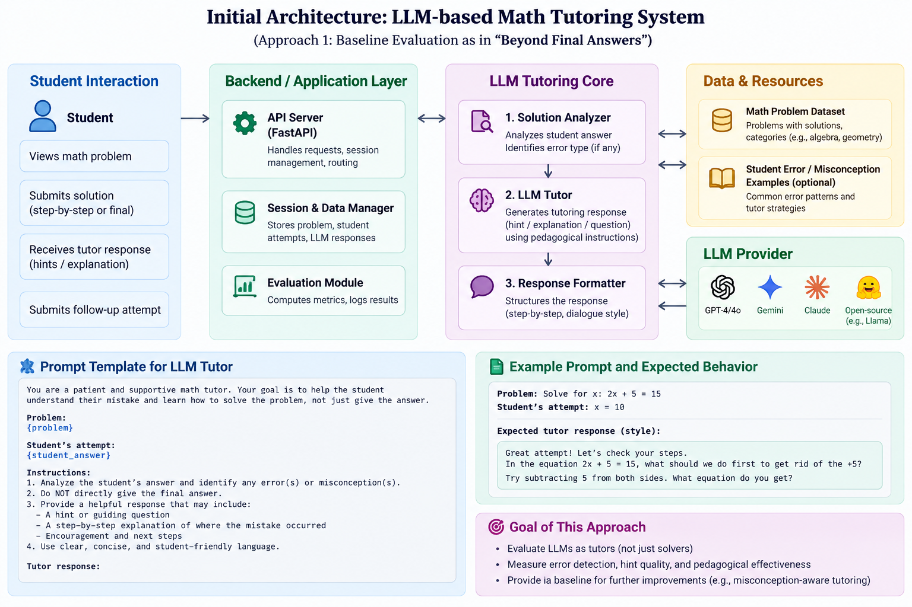

# Misconception Tutoring AI

An LLM tutor for **mathematics** and **Python** that works out *why* a student's answer is wrong, not just *whether* it is wrong. For every student message it diagnoses the specific misconception behind the error (for example "added 5 instead of subtracting it" or "believes `range(n)` includes `n`"), then replies with a Socratic guiding question aimed at that misconception, without giving the answer away.



## Contents

- [Results at a glance](#results-at-a-glance)
- [Features](#features)
- [How it works](#how-it-works)
- [Datasets](#datasets)
- [Evaluation](#evaluation)
- [Getting started](#getting-started)
- [Configuration](#configuration)
- [Project structure](#project-structure)
- [Security note](#security-note)
- [Limitations](#limitations)

## Results at a glance

These numbers are for the current tutor (v3). It was tested on 30 MathDial problems that were never used to develop it. Each problem has a real student's incorrect solution and the correct solution, and the incorrect solutions carry a human teacher's description of the misconception.

| Metric | v3 (current) | v2 | Generic tutor¹ |
|---|---|---|---|
| Error-detection accuracy | **98.3%** | 96.7% | 94.8%² |
| Correct solutions wrongly flagged as wrong | **0.0%** | 6.7% | 10.3%² |
| Misconception matches the teacher's label (exact) | **86.7%** | 66.7% | — |
| Misconception matches (exact or partial) | **100%** | 90.0% | — |
| Reply aimed at the student's actual error | **100%** | 83.3% | — |
| Reply is mathematically correct | **100%** | 76.7% | — |
| Reply quality (1–5, blinded judge) | **3.67** | 3.13 | — |
| Reply gives away the answer ↓ | 33.3% | 33.3% | — |

¹ A tutor using the same LLM that is only asked to check correctness and explain the error.<br>
² From the v1/v2 comparison on a different 30-problem set (see Experiment 2).

**The remaining weakness is answer leakage.** The strict blinded judge in Experiment 3 counted a reply as revealing the answer if it handed over a corrected step. By that standard, v2 and v3 both did so in a third of replies. The more lenient judge in Experiments 1–2 put the tutor at 0–3% and the generic tutor at 85–100%.

Full methodology, confidence intervals and all three experiments are in [Evaluation](#evaluation).

## Features

- **Misconception diagnosis.** The tutor names the faulty rule or belief and quotes the exact step where it appears. It also checks the claimed step against the student's own text, so it doesn't report errors the student never made.
- **Socratic replies.** Each reply ends with a guiding question aimed at the diagnosed error. It does not reveal the final answer, and the UI flags any reply that does.
- **Deterministic answer check.** The student's final number is compared with the target in code before the LLM judges anything, which sharply reduces correct work wrongly flagged as wrong.
- **Retrieval-grounded prompts (RAG).** Similar misconceptions, tutoring strategies and worked problems are retrieved from about 55k dataset records, along with real teacher dialogue moves (TalkMoves).
- **Python track.** Student code is checked for syntax, executed in a time-limited sandbox, and matched against a 67-entry Python misconception taxonomy, with an LLM tracing the code step by step.
- **Resilient by design.**
  - Gemini overload errors (503) are retried, then one try is made on a fallback model.
  - If the API is unreachable, a built-in rule-based tutor still answers.
  - Malformed requests get a clear 400/413 error and never crash the server.
- **Web UI.**
  - Problem bank for math, Python and cross-domain problems.
  - Custom problem editor.
  - Per-message diagnostics panel showing the diagnosis, the teaching strategy and the grounding used.

## How it works

### Math pipeline (`src/backend/conversationEngine.ts`)

Each student message goes through one LLM call that diagnoses first and replies second:

1. **Intent check.** Rules decide whether the message is a hint request, a greeting, a "where do I start", or an actual math step.
2. **Retrieval** (`src/backend/rag.ts`). Hybrid dense + lexical search returns the 3 most similar misconceptions, pedagogy strategies and problems.
3. **Answer check.** The student's final number is compared with the target answer, and the result is added to the prompt.
4. **Diagnose** (structured JSON output with Gemini thinking enabled). The model:
   - solves the problem itself;
   - finds the first line where the student departs from a correct solution;
   - labels the work `correct`, `partial`, `incorrect` or `inquiry`;
   - explains why the student wrote that line;
   - checks that the quoted step really appears in the student's message.
5. **Respond.** It picks a TalkMove (e.g. *Press for Accuracy*) and writes a reply aimed at the diagnosed error, ending with a guiding question.

### Python pipeline (`python_service/`)

1. **Syntax check** with Python's `ast` module.
2. **Sandboxed run** (`code_runner.py`):
   - a separate process with a time limit;
   - restricted builtins and no file access;
   - imports limited to a whitelist (`math`, `random`, `collections`, …).
3. **Candidate misconceptions:** the 4 closest entries from the 67-entry taxonomy (`misconception_rag.py`).
4. **Diagnosis:** the LLM writes an execution trace, verifies its claim, and names a misconception or `NONE` (`enhanced_analyzer.py`).
5. **Socratic hint** aimed at the identified construct (e.g. `range()` boundaries).

## Datasets

| Collection | Records | Source |
|---|---|---|
| Misconceptions (RAG) | 11,814 | MathDial (2,861 teacher-annotated student errors) + Eedi tutoring dialogues (8,953) |
| Pedagogy strategies (RAG) | 33,877 | MathDial teacher moves and Eedi TalkMoves |
| Problems (RAG) | 9,731 | GSM8K (8,792) + Eedi diagnostic questions (939) |
| Dialogue pairs | 22,413 | Eedi student–tutor dialogues |
| TalkMove exemplars | 1,615 | Eedi dialogues labelled with TalkMoves |
| Python misconception taxonomy | 67 | The 67-misconception taxonomy used by McMining (Al-Hossami & Bunescu, EACL 2026), drawn from SIDE-Lib, a Python misconception bank and hand-written entries |
| Python problems | 501 | MBPP (438), hand-written and other course problems |

Raw datasets are in `data/raw/`, processed files in `data/processed/`. They are rebuilt with `node scripts/process_datasets.cjs`. Hendrycks MATH and the DeepMind Mathematics dataset are bundled in `data/raw/` but are not used by the retrieval index.

## Evaluation

### Methodology

- **Test data.** The MathDial test split has 599 dialogues over 394 problems. Each sampled problem is submitted twice:
  - the real **incorrect** student solution, whose gold misconception is the teacher's annotation;
  - the **correct** reference solution, whose gold label is "correct".
- **No test leakage.** `process_datasets.cjs` indexes MathDial train and test together, so the evaluation rebuilds the RAG index **without any MathDial test problem** first.
- **Systems compared**, all on the same underlying LLM:
  - the full pipeline;
  - the same pipeline with RAG removed;
  - a **generic tutor** that is only asked to check correctness and explain the error.
- **Error detection** compares the system's verdict with the gold label. *Positive* means "the student is wrong", so recall is the share of wrong solutions caught.
- **Misconception and reply quality** are rated by an LLM judge that never grades its own model's outputs.
  - **Judge rubric:** whether the diagnosis matches the teacher's misconception (exact / partial / no match); whether it points to the right step; and, for the reply, whether it reveals the answer, targets the misconception, is mathematically correct, ends with a guiding question, plus an overall 1–5 quality score.
  - **Judge check:** on 12 random judgments of Experiment 1, a second annotator (Claude Opus 5.5) agreed 10/12 on exact match and 11/12 on match vs. no match.
- **Statistics:**
  - **Brackets:** 95% bootstrap confidence intervals, resampling whole problems.
  - **Significance:** paired exact McNemar tests (binary metrics) and Wilcoxon signed-rank tests (quality), each against the first row of its table.
- **Tuning on separate data.** Each prompt revision was designed from errors on earlier problems and then measured on problems it had never seen.

### Experiment 1: full system vs. ablation vs. generic tutor (v1, 47 problems)

LLM: `gemini-3.5-flash-lite`. Judge: `gemini-3.1-flash-lite`.

| System | Detection accuracy | F1 | Cohen's κ | Wrongly flagged correct solutions |
|---|---|---|---|---|
| Full system (RAG + TalkMoves) | 90.4% [85.1, 95.7] | 91.3% | 0.81 | 19.1% |
| w/o RAG | 90.4% [85.1, 95.7] | 91.3% | 0.81 | 19.1% |
| Generic tutor | 96.8% [92.6, 100] | 96.8% | 0.94 | 4.3% |

| System | Misconception match (exact) | Reveals answer ↓ | Ends with guiding question | Quality (1–5) |
|---|---|---|---|---|
| Full system | 66.0% | **0.0%** | **100%** | **4.19** |
| w/o RAG | 70.2% | 0.0% | 100% | 4.09 |
| Generic tutor | 61.7% | 85.1%\*\*\* | 14.9%\*\*\* | 2.72\*\*\* |

What this experiment found:
- **The tutor's real strength is the reply.** It never revealed the answer and always asked a guiding question; the generic tutor gave the answer away 85% of the time.
- **RAG made no measurable difference.** The two versions disagree on 18 individual labels but reach the same totals.
- **v1 wrongly flagged 19% of correct solutions,** and v2 was built to fix this.

### Experiment 2: original (v1) vs. v2 prompt (30 unseen problems)

LLM: `gemini-3.5-flash-lite`. Judge: `gemini-3.1-flash-lite`.

v2 added the deterministic answer check, decides correctness before diagnosing, and enforces a JSON schema.

| System | Detection accuracy | Wrongly flagged correct solutions | Misconception match | Quality |
|---|---|---|---|---|
| **v2** | **96.6%** [91.4, 100] | **6.9%** | 65.5% | 4.14 |
| v1 | 84.5% [75.9, 93.1]\* | 31.0% | 62.1% | 3.93 |
| Generic tutor | 94.8% | 10.3% | 58.6% | 2.59\*\*\* |

### Experiment 3: v2 vs. v3 (30 more unseen problems)

LLM: `gemini-3.1-flash-lite`. Judge: Claude Opus 5.5, **blinded** to which version wrote each reply.

v3 enables Gemini's thinking mode, writes the diagnosis before the reply, and verifies that the quoted error step is really in the student's work.

| System | Detection accuracy | Wrongly flagged | Misconception exact | Exact or partial | Error step located | Targets error | Math-correct reply | Reveals answer ↓ | Guiding question | Quality |
|---|---|---|---|---|---|---|---|---|---|---|
| **v3 (current)** | **98.3%** | **0.0%** | **86.7%** [73, 97] | **100%** | **96.7%** | **100%** | **100%** | 33.3% | **73.3%** | **3.67** |
| v2 | 96.7% | 6.7% | 66.7% [50, 83] | 90.0% | 93.3% | 83.3% | 76.7%\* | 33.3% | 63.3% | 3.13\* |

This judge is much stricter than the Gemini judge in Experiments 1–2: it counts a reply that hands over the corrected step as revealing the answer, and a guiding question only if it makes the student reason. So compare numbers within this table, not across experiments.

\* p < 0.05, \*\*\* p < 0.001 (paired tests).

Full tables, with Markdown and LaTeX versions, are in [`data/evaluation/`](data/evaluation/):

| Folder | Experiment |
|---|---|
| `results_gemini-3.5-flash-lite/` | 1 |
| `results_heldout/` | 2 |
| `results_test3/` | 3 |

Each folder contains `predictions.jsonl`, `judgments.jsonl`, `metrics.json`, `report_tables.md` and `report_tables.tex`.

### Reproducing the evaluation

```bash
# 1. Generate tutor replies (resumable; free-tier quota is rotated across EVAL_GEMINI_API_KEY keys)
npx tsx scripts/evaluate_math.ts --n 30 --offset 80 --seed 42 --systems full,baseline \
  --system-model gemini-3.1-flash-lite --judge-model gemini-3.5-flash-lite --out data/evaluation/my_run

# 2. Build the tables (bootstrap CIs + paired significance tests)
python scripts/analyze_eval.py --dir data/evaluation/my_run
```

Useful flags:

| Flag | What it does |
|---|---|
| `--offset` | Picks a disjoint slice of problems for held-out testing |
| `--judge-only` | Grades saved replies without generating new ones |
| `--systems` | Any of `full`, `norag`, `baseline` |
| `--interval-ms` | Spaces out API calls for rate limits |

## Getting started

### Prerequisites

- Node.js 20.11+
- Python 3.10+ (for the Python track)
- A Gemini API key from [Google AI Studio](https://aistudio.google.com/)

### Install and run

```bash
npm install
pip install -r python_service/requirements.txt
cp .env.example .env          # then put your key in GEMINI_API_KEY
npm run dev
```

Open <http://localhost:3000>.

The Python track works without any extra setup: the server runs the analyzer as a subprocess. Optionally, you can run it as a separate service:

```bash
python -m python_service.api          # FastAPI on http://127.0.0.1:8000
```

If something else already uses port 8000, start the service with a different port and point the app at it:

```bash
PYTHON_SERVICE_PORT=8010 python -m python_service.api
```

Then set `PYTHON_SERVICE_URL=http://127.0.0.1:8010` in `.env`.

### Production build

```bash
npm run build
npm start
```

## Configuration

All settings go in `.env`; see `.env.example`.

| Variable | Default | Purpose |
|---|---|---|
| `GEMINI_API_KEY` | — | Required. Gemini API key. |
| `GEMINI_MODEL` | `gemini-2.5-flash` | Tutor model. New API keys cannot use 2.5 models; use e.g. `gemini-3.5-flash-lite`. |
| `GEMINI_THINKING_LEVEL` | `HIGH` | Reasoning effort for `gemini-3*` models (`LOW` is faster). |
| `GEMINI_FALLBACK_MODEL` | `gemini-3.1-flash-lite` | Tried once if the main model is overloaded. Set to `""` to disable. |
| `PYTHON_BIN` | `python` (Windows) / `python3` | Interpreter for the Python track. |
| `PYTHON_SERVICE_URL` | `http://127.0.0.1:8000` | Optional FastAPI service for the Python track. |
| `HOST` | `127.0.0.1` | Interface the web server listens on. |
| `EVAL_GEMINI_API_KEY` | — | Comma-separated keys used only by the evaluation script. |

## Project structure

```
server.ts                      Express server: /api/chat, /api/python/run, Vite dev middleware
src/
  App.tsx, components/         React UI (chat, problem bank, custom problems, diagnostics panel)
  backend/conversationEngine.ts  Math tutoring pipeline + rule-based fallback tutor
  backend/rag.ts                 Hybrid dense/lexical retrieval over the processed datasets
  backend/pythonTutorBridge.ts   Calls the Python analyzer (HTTP service or subprocess)
  data/                          Built-in math, Python and cross-domain problems
python_service/
  api.py                       FastAPI service for the Python track
  code_runner.py               Syntax check + time-limited sandboxed execution
  enhanced_analyzer.py         LLM misconception mining with trace + verification
  misconception_rag.py         67-entry Python misconception taxonomy retrieval
scripts/
  evaluate_math.ts             Offline evaluation harness (leak-free RAG index, LLM judge)
  analyze_eval.py              Metrics, bootstrap CIs, significance tests, report tables
  process_datasets.cjs         Builds data/processed/ from data/raw/
data/evaluation/               Evaluation predictions, judgments and report tables
```

## Security note

The Python track executes student code. `code_runner.py` reduces the risk in several ways:
- code runs in a separate process that is killed after 3 seconds;
- it gets no environment variables and a throwaway working directory;
- `open`, `exec` and `eval` are removed;
- imports must come from a whitelist;
- double-underscore attribute access is refused;
- on Linux and macOS, memory and CPU are also capped.

This is **not** a security boundary against a determined attacker. For that reason, both the web server and the Python service listen on `127.0.0.1` only by default. Before exposing the app to other users, run the code runner inside a container or another OS-level sandbox.

## Limitations

- **Small test sets.** Evaluation sets have 29–47 problems, so the confidence intervals are wide. The v2 → v3 gains in misconception match (+20 pts, p = 0.07) and targeting (+17 pts, p = 0.06) are not yet statistically significant.
- **Not the default model.** The reported results use `gemini-3.5-flash-lite` and `gemini-3.1-flash-lite`, not the default `gemini-2.5-flash`.
- **Simulated students.** MathDial's student solutions were produced by an LLM role-playing a student; the teachers' misconception labels are real.
- **Noisy gold labels.** Some teacher annotations are vague ("had a hard time understanding the problem"), which caps how high the exact-match scores can go.
- **RAG adds no measurable benefit yet.** Experiment 1 found no gain from it. Those runs also used an embedding cache that gave many records another record's embedding; this is now fixed, but RAG has not been re-measured since.
- **The Python track is less evaluated.** It has been tested functionally but not yet benchmarked on the McMining dataset.

## Tech stack

- **Frontend:** React 19, TypeScript, Tailwind CSS 4, Vite, Motion, Lucide icons
- **Backend:** Node.js, Express, `@google/genai`
- **Python service:** FastAPI, `ast`, `google-generativeai`
- **Evaluation:** TypeScript harness, Python (SciPy) for statistics

## Acknowledgements

Datasets:
- [MathDial](https://github.com/eth-nlped/mathdial)
- [Eedi](https://eedi.com/) diagnostic questions and tutoring dialogues
- [GSM8K](https://github.com/openai/grade-school-math)
- [MBPP](https://github.com/google-research/google-research/tree/master/mbpp) (Python problems)

The Python misconception taxonomy and problems come from McMining (Al-Hossami & Bunescu, *EACL 2026*).
