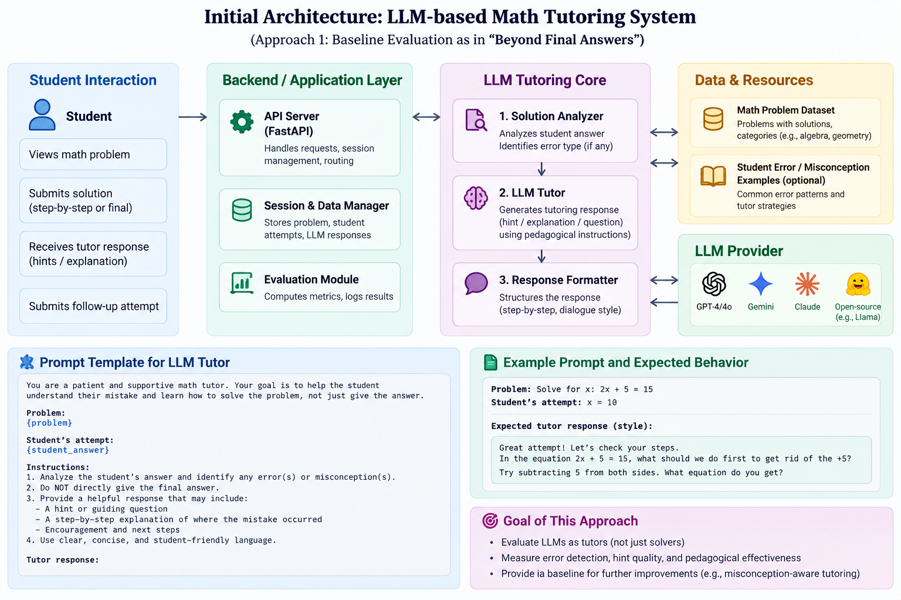

# Misconception Tutoring AI

An LLM-based pedagogical tutoring system with multi-stage solution analysis, adaptive Socratic dialogue, real-time misconception detection, and automated execution tracing across Mathematics and Python.

## Features

- **Multi-Stage Solution Analysis**: Dissects student attempts step-by-step rather than just providing final answers.
- **Misconception Detection & RAG Pipeline**: Leverages curated misconception taxonomies (EEDI, MathDial, GSM8K, and Python AST runtime tracing) to diagnose underlying reasoning gaps.
- **Adaptive Socratic Dialogue**: Pedagogical coaching and scaffolded hints tailored to student competency levels.
- **Python Execution & AST Analysis**: Safe execution environment with mental execution tracing for syntax and logic errors.
- **Rich Interactive UI**: Modern dark-mode interface with live chat, problem bank, custom problem editor, and architectural inspection panel.

## Architecture



## Getting Started

### Prerequisites

- Node.js (v18+)
- Python 3.10+ (for Python tutoring service)

### Installation

1. **Install Node dependencies:**
   ```bash
   npm install
   ```

2. **Configure Environment Variables:**
   Copy `.env.example` to `.env`:
   ```bash
   cp .env.example .env
   ```
   Add your Gemini API key:
   ```env
   GEMINI_API_KEY="your-api-key-here"
   ```

3. **Run the Development Server:**
   ```bash
   npm run dev
   ```
   Open [http://localhost:3000](http://localhost:3000) in your browser.

## Evaluation

The math pipeline is evaluated offline on the MathDial test split: each sampled problem is submitted twice
(the real, teacher-annotated incorrect student solution and the reference solution), and the full pipeline is
compared with a no-RAG ablation and a generic-tutor baseline that uses the same LLM. An LLM judge compares
the diagnosed misconception with the teacher's annotation and rates the tutor reply.

```bash
npx tsx scripts/evaluate_math.ts --n 50 --seed 42 --systems full,baseline,norag \
  [--system-model gemini-2.5-flash] [--judge-model gemini-3.5-flash] [--out data/evaluation/results]
python scripts/analyze_eval.py --dir data/evaluation/results
```

- The RAG index is rebuilt without any MathDial test problem before evaluating (`process_datasets.cjs` indexes train and test together).
- Runs resume where they stopped; `EVAL_GEMINI_API_KEY` in `.env` may list several comma-separated keys, rotated when one hits its daily quota.
- `analyze_eval.py` writes `report_tables.md`, `report_tables.tex` and `metrics.json` (95% bootstrap CIs, paired McNemar/Wilcoxon tests).

## Tech Stack

- **Frontend**: React 19, TypeScript, Tailwind CSS, Motion, Lucide Icons, Three.js
- **Backend**: Express, TSX, Node.js
- **AI / LLM**: Google GenAI SDK (`@google/genai`), RAG pipeline
- **Python Service**: AST parser, Python code runner, misconception classifier
